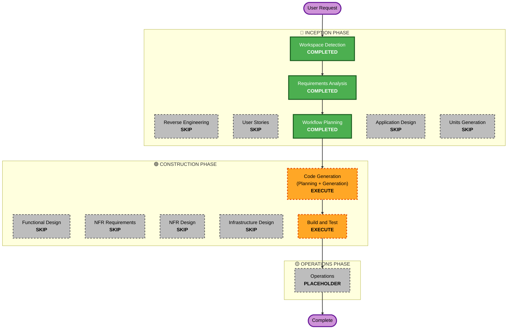

# Execution Plan — `auth-port`: Apply the Responsive Auth Design in `frontend/`

**Unit**: `auth-port`
**Date**: 2026-10-31
**Source artifact**: `context-docs/mockups/08-responsive-login-register.html` (approved, 313 automated checks green)
**Requirements**: `aidlc-docs/inception/requirements/auth-port/requirements.md`

---

## Detailed Analysis Summary

### Transformation Scope (Brownfield)

- **Transformation Type**: **Single-component transformation** — the `features/auth/` module of an existing SPA, plus the shared token layer and the HTML entry point.
- **Primary Changes**: Decompose the approved single-file `responsive-auth` design artifact into React components inside the existing feature-based tree; replace the two existing auth pages with the new two-panel design; introduce auth-scoped design tokens including a light theme; wire the tabs to the two existing routes; port the artifact's validation lifecycle, ARIA tab pattern, motion and accessibility into React.
- **Related Components**: `frontend/src/features/auth/**` (primary), `frontend/src/styles/tokens.css` (new auth-scoped token block — existing tokens untouched), `frontend/index.html` (Google Fonts stylesheet with SRI). **Not** touched: `backend/**`, `frontend/src/features/chat/**`, `frontend/src/features/citations/**`, `frontend/src/features/settings/**`, `frontend/src/shared/**`, `frontend/src/app/**`.

### Change Impact Assessment

- **User-facing changes**: **Yes — substantial.** The sign-in and create-account screens are completely redesigned. The layout, palette, typography, copy, motion, and the entire interaction model of the auth surface change. This is the app's first-impression surface.
- **Structural changes**: **Yes, bounded.** New React components are added under `features/auth/components/`; `LoginPage.tsx` and `RegisterPage.tsx` are rewritten; `AuthCard.tsx` is superseded. The module boundary (`features/auth/`) and the app's routing model are unchanged — **no new route, no new feature area, no new top-level directory**.
- **Data model changes**: **No.** No schema, no persisted shape, no storage key. `jlca_token` / `jlca_user` are untouched.
- **API changes**: **No.** The frontend continues to consume `aidlc-docs/inception/api-contract.md` exactly as-is. `POST /api/auth/login` and `POST /api/auth/register` are called exactly as they are today.
- **NFR impact**: **Yes.** Accessibility (the ARIA tab pattern, the error lifecycle, the `aria-live` announcements), contrast (a new light theme), responsiveness (a 900px breakpoint with a 200px banner), performance (a 6s animated sweep and a staggered fade), and security (client-side validation before any request, an 8-character password minimum, SRI on the font CDN) all land on this surface.

### Component Relationships

```
                    ┌──────────────────────────────────────────────┐
                    │  backend/  (UNCHANGED — byte-identical)       │
                    │  FastAPI :8000                               │
                    │  POST /api/auth/login   POST /api/auth/register│
                    └───────────────────┬──────────────────────────┘
                                        │ HTTP (contract fixed)
                    ┌───────────────────▼──────────────────────────┐
                    │  frontend/src/shared/api/                    │
                    │  client.ts · endpoints.ts · types.ts         │
                    └───────────────────┬──────────────────────────┘
                                        │
                    ┌───────────────────▼──────────────────────────┐
                    │  frontend/src/app/                           │
                    │  routes.tsx (ROUTES.LOGIN / ROUTES.REGISTER) │
                    │  providers.tsx (useSession)  guards.tsx       │
                    └───────────────────┬──────────────────────────┘
                                        │
        ┌───────────────────────────────▼───────────────────────────────┐
        │  features/auth/          ◄── THE ONLY FEATURE AREA CHANGED   │
        │                                                               │
        │  pages/                                                      │
        │    LoginPage.tsx      (rewritten)                             │
        │    RegisterPage.tsx   (rewritten)                             │
        │      │                                                        │
        │      ▼                                                        │
        │    AuthScreen.tsx      (new — the shared two-panel shell)    │
        │      ├── AuthArtwork.tsx  (new — contract page + 3 cards)    │
        │      ├── AuthTabs.tsx     (new — APG tablist + underline)     │
        │      ├── PasswordField.tsx(new — Show/Hide toggle)            │
        │      ├── GoogleButton.tsx (new — brand mark + outline button) │
        │      ├── AuthNotice.tsx    (new — inline notice region)       │
        │      └── useAuthValidation.ts (new — shared FR-4 rule set)    │
        │                                                               │
        │  styles/auth.css     (rewritten — 6 commented sections)       │
        └───────────────────────────────┬───────────────────────────────┘
                                        │
                    ┌───────────────────▼──────────────────────────┐
                    │  frontend/src/styles/tokens.css               │
                    │  20 existing tokens — UNCHANGED (FR-8.7)     │
                    │  + new .auth-page scoped token block         │
                    │  + @media (prefers-color-scheme: light)       │
                    │    override scoped to the auth form panel    │
                    └───────────────────┬──────────────────────────┘
                                        │
                    ┌───────────────────▼──────────────────────────┐
                    │  frontend/index.html                          │
                    │  + Google Fonts stylesheet (SRI-protected)    │
                    └──────────────────────────────────────────────┘

  UNCHANGED and MUST NOT REGRESS:
    features/chat/**  ·  features/citations/**  ·  features/settings/**
    shared/**  ·  config/brand.ts  ·  assets/{logo,wave-field}.svg
    app/guards.tsx  ·  app/providers.tsx  ·  package.json
```

### Component Change Register

| Component | Change Type | Reason | Priority |
|---|---|---|---|
| `features/auth/pages/LoginPage.tsx` | Major (rewrite) | Must render the new design; must keep the real submit | Critical |
| `features/auth/pages/RegisterPage.tsx` | Major (rewrite) | Must render the new design; must keep the real submit | Critical |
| `features/auth/components/AuthScreen.tsx` | New | The shared two-panel shell both pages render | Critical |
| `features/auth/components/AuthArtwork.tsx` | New | The artwork panel — contract page, scan line, 3 annotation cards | Critical |
| `features/auth/components/AuthTabs.tsx` | New | The APG tablist, roving tabindex, sliding underline | Critical |
| `features/auth/components/PasswordField.tsx` | New | The Show/Hide password toggle | Important |
| `features/auth/components/GoogleButton.tsx` | New | The outline button with the Google brand mark | Important |
| `features/auth/components/AuthNotice.tsx` | New | The inline notice region | Important |
| `features/auth/hooks/useAuthValidation.ts` | New | The shared FR-4 validation rule set and error lifecycle | Critical |
| `features/auth/components/AuthCard.tsx` | Removed | Superseded by `AuthScreen` — the old centred-card shell no longer exists | Important |
| `features/auth/styles/auth.css` | Major (rewrite) | The entire auth visual design | Critical |
| `styles/tokens.css` | Minor (append) | Auth-scoped tokens + light-theme override. **The 20 existing tokens are not touched.** | Critical |
| `index.html` | Minor (edit) | The SRI-protected Google Fonts stylesheet | Important |
| `config/brand.ts` | Minor (read only) | `BRAND.name` and `BRAND.tagline` are reused by the new components | Optional |
| `backend/**` | **None** | Out of scope | — |
| `features/chat/**`, `features/citations/**`, `features/settings/**` | **None** | Out of scope — no selector they use may change | — |
| `package.json` | **None** | No new dependency (FR-8.6) | — |

### Risk Assessment

- **Risk Level**: **Medium**
- **Rollback Complexity**: **Easy** — the change is confined to one feature directory plus two appended file edits. There is no database migration, no API contract change, and no persisted state. Rollback = restore `features/auth/`, revert the two appended edits.
- **Testing Complexity**: **Moderate** — there is no test runner in the project. Correctness rests on `tsc -b` + `oxlint` + `vite build`, a static verifier (the artifact's 152 checks, re-pointed), and a CDP harness (the artifact's 115 integration checks, re-pointed). The largest regression surface is CSS: an auth-scoped selector that leaks into the chat area.

**Principal risks:**

| # | Risk | Likelihood | Mitigation |
|---|---|---|---|
| R1 | A new auth CSS selector collides with a chat/citation/settings selector and restyles that area | Medium | Scope every new rule under `.auth-page` / `.auth-form-panel`; diff the full selector inventory before and after; render the chat page and compare |
| R2 | The light-theme block leaks out of the auth panel and restyles the whole app in light mode | Medium | Scope the `@media (prefers-color-scheme: light)` override to `.auth-form-panel`; assert in the verifier that the override's selector list contains no global element selector |
| R3 | The tab-to-route binding breaks the `RedirectIfAuthenticated` guard or creates a redirect loop | Medium | The tabs call `navigate(ROUTES.X)` — the same navigation the existing cross-links already perform; both routes stay registered and both guards keep their current predicates |
| R4 | The two existing `data-testid` families collide on one element | Low | The app's testids and the artifact's testids are on different elements; where both apply, the element carries exactly one `data-testid` attribute — the app's — and the artifact's is applied to the nearest equivalent distinct element |
| R5 | The 8-character client-side minimum diverges from the server's rule and rejects a password the server accepts | Low | The client's rule is a **minimum**, so it accepts every password the server accepts; it only rejects shorter ones, which the server would also reject. Read the server rule from `api-contract.md` before finalising the message |
| R6 | The D9 / D10 defects are reintroduced in the port | Medium | The fixes are carried across verbatim — the `min()` width cap with `--card-left`, and the explicit theme-invariant `color` on the card — and are asserted in the port verifier |
| R7 | The Google Fonts stylesheet's SRI hash goes stale and the fonts silently fail to load | Low | The hash is copied verbatim from the verified artifact; the fallback stack (`Georgia`, `system-ui`) renders correctly without the CDN |

---

## Workflow Visualization



**Text alternative (in case Mermaid fails to render):**

```
INCEPTION
  1. Workspace Detection   — COMPLETED
  2. Reverse Engineering   — SKIP
  3. Requirements Analysis — COMPLETED
  4. User Stories          — SKIP
  5. Workflow Planning     — COMPLETED
  6. Application Design    — SKIP
  7. Units Generation      — SKIP
CONSTRUCTION
  8. Code Generation       — EXECUTE
  9. Build and Test        — EXECUTE
OPERATIONS
 10. Operations            — PLACEHOLDER
```

---

## Phases to Execute

### 🔵 INCEPTION PHASE

- [x] Workspace Detection (COMPLETED) — brownfield; the SPA and the FastAPI backend were scanned; `aidlc-state.md` was resumed.
- [x] Reverse Engineering (SKIPPED)
  - **Rationale**: `aidlc-docs/inception/api-contract.md` already captures the architecture, the component inventory and the technology stack. The completed `responsive-auth` unit additionally captured the exact design being ported. Re-running reverse engineering would reproduce two existing artifacts.
- [x] Requirements Analysis (COMPLETED) — `aidlc-docs/inception/requirements/auth-port/requirements.md`
  - **Rationale**: Standard depth. The design decisions were already made and approved in the source unit, so the questions this unit had to answer were integration questions — how the prototype's demo-only behaviour maps onto the app's real API-backed behaviour, how the prototype's one-page/two-tab model maps onto the app's two-route model, and how the existing `data-testid` / id / token contracts survive. All nine are recorded as decisions D1–D9 with their reasoning.
- [x] Workflow Planning (COMPLETED) — this document.
- [ ] User Stories (SKIP)
  - **Rationale**: One persona (an unauthenticated visitor), one screen, and the acceptance criteria are already captured precisely in FR-1…FR-8 and NFR-1…NFR-6. There is no new user journey — the user journey is unchanged; only its presentation is redesigned. Stories would restate the requirements without adding information.
- [ ] Application Design (SKIP)
  - **Rationale**: The new components and their contracts are fully determined: the source artifact specifies every element's markup and every rule's behaviour, and the requirements specify the module boundaries (`features/auth/components/`), the shared validation module, and the token scoping. There is no component whose methods or dependencies need designing — they are being decomposed from an existing, verified implementation.
- [ ] Units Generation (SKIP)
  - **Rationale**: Single cohesive unit. All the changes share one dependency graph inside `features/auth/`, touch no shared external contract, and must land atomically — a partial application would not compile or would render a broken layout. Splitting into parallel units would create coordination overhead with no independent deliverable.

### 🟢 CONSTRUCTION PHASE

- [ ] Functional Design (SKIP)
  - **Rationale**: The only new business logic is the validation rule set and the error lifecycle — and both are fully specified in FR-4.1…FR-4.9 and are ported verbatim from the artifact's already-verified implementation. There is no data model, no schema, and no new business rule to design.
- [ ] NFR Requirements (SKIP)
  - **Rationale**: The NFRs are already written and quantified in the requirements document (NFR-1…NFR-6), inherited from the source unit's approved NFRs and the security-baseline extension. Re-assessing them would duplicate approved work; they are carried into Code Generation as implementation constraints.
- [ ] NFR Design (SKIP)
  - **Rationale**: Follows NFR Requirements. These NFRs are implementation-level constraints — contrast ratios, a breakpoint value, SRI, an 8-character minimum, no new dependency — not architectural patterns requiring a separate design artifact. Each maps to a specific rule in a specific file, listed in the code generation plan.
- [ ] Infrastructure Design (SKIP)
  - **Rationale**: No infrastructure changes. No new service, cloud resource, container, environment variable, deployment target, or dependency. The backend, the Postgres compose setup and the Vite proxy configuration are all untouched.
- [ ] Code Generation (EXECUTE)
  - **Rationale**: This is where the port is produced — the React decomposition, the CSS, the token block, the font stylesheet, and the verifier that re-points the artifact's 313 checks at the running app.
- [ ] Build and Test (EXECUTE)
  - **Rationale**: Required to verify the SPA compiles and bundles, to re-point and run the static and CDP verification suites against the running app, and to produce the build-and-test instruction set.

### 🟡 OPERATIONS PHASE

- [ ] Operations (PLACEHOLDER)
  - **Rationale**: Per `.aws-aidlc-rule-details/operations/operations.md`, all build and test activity has moved to the CONSTRUCTION phase; the workflow ends after Build and Test. No deployment, monitoring, or incident-response stage exists in this workflow version.

---

## Package Change Sequence

**Single package** (`frontend/`), sequenced internally so the tree compiles at every step.

- **Update Approach**: **Sequential** within the package.
- **Critical Path**: `styles/tokens.css` + `index.html` (the token and font substrate) → `features/auth/styles/auth.css` (the visual layer) → `features/auth/components/*` (the React decomposition) → `features/auth/pages/*` (the wiring) → verification.
- **Coordination Points**:
  - `styles/tokens.css` — the auth token block must be additive; the 20 existing tokens must keep their exact values.
  - `index.html` — the SRI hash on the font stylesheet.
  - `app/routes.tsx` — `ROUTES.LOGIN` / `ROUTES.REGISTER` are read by the new tab component; the route table is **not** modified.
  - `app/providers.tsx` — `useSession().signIn/signUp` are called exactly as today; the session context is **not** modified.
- **Testing Checkpoints**:
  1. `npm run build` after the components are written but before the pages are rewired — catches type errors in isolation.
  2. `npm run lint` after each CSS/component batch.
  3. `npm run build` again after the pages are rewired.
  4. The static verifier and the CDP harness against the built app.

### Internal Execution Steps (Code Generation)

| Step | Work | Depends on |
|---|---|---|
| S1 | Append the auth-scoped token block + the light-theme override to `styles/tokens.css`; add the SRI-protected Google Fonts stylesheet to `index.html` | — |
| S2 | Rewrite `features/auth/styles/auth.css` in 6 commented sections (tokens usage, layout, artwork, form, responsive, reduced motion) | S1 |
| S3 | Create `features/auth/hooks/useAuthValidation.ts` — the shared FR-4 rule set, the error lifecycle, the `aria-live` announcement | — |
| S4 | Create `features/auth/components/AuthArtwork.tsx` — brand lockup, contract page, numbered clauses, highlights, skeleton bars, scan line, connector SVG, 3 annotation cards | S2 |
| S5 | Create `features/auth/components/AuthTabs.tsx` — the APG tablist, roving tabindex, arrow/Home/End, sliding underline, route navigation | S2 |
| S6 | Create `features/auth/components/PasswordField.tsx`, `GoogleButton.tsx`, `AuthNotice.tsx` | S2 |
| S7 | Create `features/auth/components/AuthScreen.tsx` — the two-panel shell, the form region, the disclaimer footer | S3, S4, S5, S6 |
| S8 | Rewrite `LoginPage.tsx` and `RegisterPage.tsx` to render `AuthScreen` with their mode; keep the real submit, the navigation, and every existing `data-testid` / id | S7 |
| S9 | Delete the superseded `AuthCard.tsx` | S8 |
| S10 | Write the port verifier — a static check of the React sources against FR-1…FR-8, plus a re-pointed CDP integration harness | S8 |
| S11 | Verify: `npm run lint`, `npm run build`; run the verifier and the harness; confirm `backend/` and `package.json` are unchanged | S10 |

**Rollback**: S1 and S2 are independently revertible. S3–S9 must revert as a group to keep the tree compiling. S10–S11 are documentation and tooling.

---

## Estimated Timeline

- **Total Stages**: 10 (5 executed, 4 skipped, 1 placeholder)
- **Estimated Duration**: Single focused session — the design is already specified and verified, so the work is decomposition plus a careful integration, with no dependency installation and no backend work.

---

## Success Criteria

- **Primary Goal**: The running LegalWave SPA's sign-in and create-account screens render the approved responsive-auth design — the split artwork/form layout, the artwork panel, the tabbed form, the palette, the typography, the motion, and the accessibility pattern — while continuing to authenticate against the existing backend.
- **Key Deliverables**:
  1. `features/auth/components/AuthScreen.tsx`, `AuthArtwork.tsx`, `AuthTabs.tsx`, `PasswordField.tsx`, `GoogleButton.tsx`, `AuthNotice.tsx`, and `features/auth/hooks/useAuthValidation.ts`.
  2. `LoginPage.tsx` and `RegisterPage.tsx` rewritten onto the new shell, with the real submit intact.
  3. `features/auth/styles/auth.css` rewritten — the full design, in 6 commented sections, 0 raw hex outside the token block.
  4. `styles/tokens.css` extended with the auth-scoped tokens and the scoped light theme; the 20 existing tokens byte-identical.
  5. `index.html` carrying the SRI-protected Google Fonts stylesheet.
  6. The artifact's static verifier re-pointed at the React sources, plus a CDP integration harness against the built app.
- **Quality Gates**:
  - `npm run lint` → zero errors.
  - `npm run build` → zero errors, including `noUnusedLocals` and `verbatimModuleSyntax`.
  - `package.json` → no dependency changes.
  - `backend/` → no diff.
  - `styles/tokens.css` → the 20 original token declarations unchanged.
  - Every existing `data-testid` and element id present on the rendered page.
  - The static verifier green; the CDP harness green at 14 viewport widths × 2 themes.
  - Zero horizontal overflow from 320px to 2560px, with the 901–1000px band explicitly covered.
  - The chat, citation and settings screens render unchanged.
- **Integration Testing**: `/login` and `/register` both render; the tabs navigate between them; the sign-in and registration requests still succeed against the backend; the error path still surfaces the server's message in the existing error element.
- **Operational Readiness**: N/A — no infrastructure change.

---

## Extension Compliance Summary

| Extension | Status | Rationale |
|---|---|---|
| security-baseline | **Enabled** | Enforced. SECURITY-05 → FR-4.9 and NFR-4.1 (validation runs before any request, and the submit handler re-runs it rather than trusting a flag); SECURITY-09 → NFR-4.3 (no default credentials, no hardcoded keys, no new endpoint URLs); SECURITY-12 → FR-4.6 and NFR-4.4/NFR-4.5 (8-character minimum, no password storage or logging); SECURITY-13 → NFR-4.6 and S1 (SRI on the font CDN); SECURITY-15 → NFR-4.7 (the busy flag is cleared in a `finally`, and the failure message is generic). The infrastructure rules are **N/A** — this unit changes no infrastructure. |
| resiliency-baseline | **Not enabled** (opted out) | N/A — the extension's rules were never loaded, so they are not enforced. Every rule targets a deployed, distributed or stateful workload; this unit touches presentation code and two already-existing HTTP calls. There is no new workload, data store, or runtime to make resilient. |
| property-based-testing | **Not enabled** (opted out) | N/A — the extension's rules were never loaded. PBT-09 requires a framework dependency, and FR-8.6 forbids adding one. The project has no test runner; verification is by the existing static/build tooling plus the CDP harness that already exists outside the repository. |
