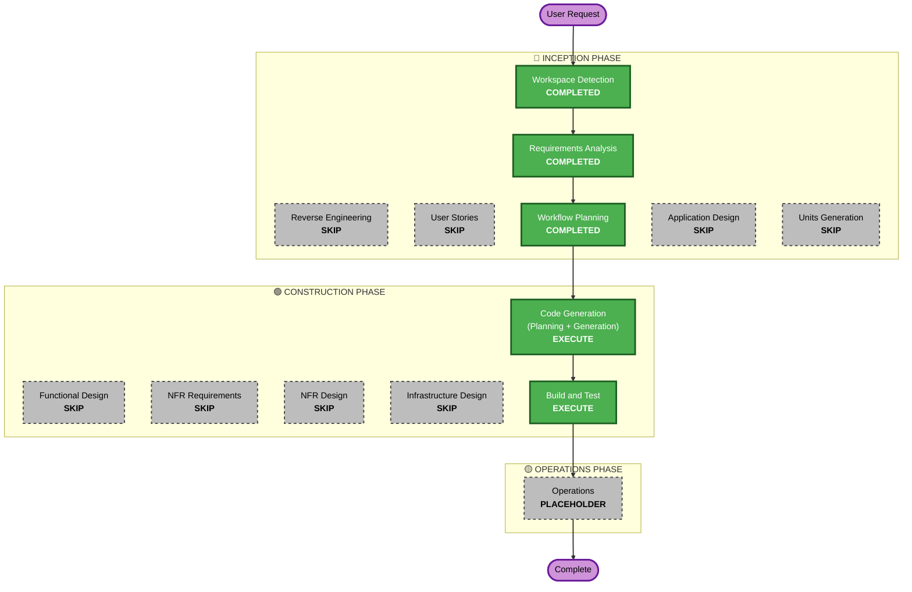

# Execution Plan — LegalWave Frontend Rebrand & Modular Restructure

## Detailed Analysis Summary

### Transformation Scope (Brownfield)
- **Transformation Type**: Architectural transformation (application layer only)
- **Primary Changes**: Reorganise `frontend/src/` from a flat layout into a feature-based, layered structure; dissolve the 349-line `Shell.tsx` monolith into a `ChatPage` plus five focused chat components; split the single 180-line global `styles.css` into per-area files plus a token layer; split `api.ts` into `client.ts` / `types.ts` / `endpoints.ts`; introduce an auth session context; add a dedicated `/register` route; rebrand all user-visible surfaces to LegalWave with a new inline-SVG logo and an SVG wave-field background.
- **Related Components**: `frontend/` only. The `backend/` package is explicitly out of scope and must remain byte-identical.

### Change Impact Assessment
- **User-facing changes**: **Yes** — new `/register` route; renamed product identity across auth screens, app chrome, and settings; new logo; new artistic background; MCP server key renamed `legal-assistant` → `legalwave` with an accompanying note. Existing chat, streaming, citation, and history behaviour is unchanged.
- **Structural changes**: **Yes** — substantial source-tree reorganisation; every import path in the frontend changes. No public API of the module graph is relied upon externally.
- **Data model changes**: **No** — no database, schema, or persisted-shape change. `localStorage` keys `jlca_token` / `jlca_user` are preserved verbatim so existing sessions survive.
- **API changes**: **No** — the frontend consumes `aidlc-docs/inception/api-contract.md` exactly as-is. `POST /api/auth/register` and `POST /api/auth/login` already exist as separate backend endpoints; the route split is a frontend-only concern.
- **NFR impact**: **Yes, bounded** — introduces a background rendering layer (perf + accessibility), a session context (correctness of guard behaviour), and a per-area CSS split (visual-regression risk if selectors are dropped during the move).

### Component Relationships

```
                    ┌──────────────────────────────┐
                    │  backend/  (UNCHANGED)       │
                    │  FastAPI :8000                │
                    │  /api/auth/{register,login}   │
                    │  /api/chats/stream (NDJSON)   │
                    │  /api/laws/...  /api/keys     │
                    └──────────────┬───────────────┘
                                   │ HTTP (contract fixed)
                    ┌──────────────▼───────────────┐
                    │  frontend/src/shared/api/    │
                    │  client.ts  ← single gateway │
                    │  endpoints.ts  types.ts      │
                    └───┬──────────────────────┬───┘
                        │                      │
       ┌────────────────▼──────┐   ┌──────────▼─────────────────┐
       │ features/auth/        │   │ features/chat/            │
       │  LoginPage            │   │  ChatPage                 │
       │  RegisterPage         │   │   ├ ChatSidebar           │
       │  useAuthSession ──────┼───┤   ├ ChatThread            │
       │  guards (app/)        │   │   ├ Composer              │
       └────────┬─────────────┘   │   └ MessageView           │
                │                 │  useChats useChatStream     │
                │                 └──────────┬─────────────────┘
                │                            │
                │                 ┌──────────▼─────────────────┐
                │                 │ features/citations/        │
                │                 │  CitationModal             │
                │                 └────────────────────────────┘
                │
                │                 ┌────────────────────────────┐
                └────────────────►│ features/settings/         │
                    session ctx    │  SettingsPage (MCP key)    │
                                  └────────────────────────────┘

       ┌────────────────────────────────────────────────────────┐
       │ config/brand.ts  ← single source of truth for name   │
       │ assets/{logo.svg, wave-field.svg}                     │
       │ styles/{tokens.css, global.css}                       │
       └────────────────────────────────────────────────────────┘
```

- **Primary Component**: `frontend/src/`
- **Shared Components**: `shared/api/client.ts` (the sole HTTP gateway), `shared/api/types.ts` (all domain types), `config/brand.ts` (brand constants), `styles/tokens.css` (design tokens)
- **Dependent Components**: every feature depends on `shared/api` and `config/brand`; `app/guards.tsx` depends on the auth session context
- **Supporting Components**: `assets/` (logo, background), per-area CSS files

### Component Change Register

| Component | Change Type | Reason | Priority |
|---|---|---|---|
| `shared/api/*` | Major (split) | `api.ts` mixes types, client, session, and streaming | Critical |
| `app/` (routes, guards, providers) | New | Route table split; symmetric guards need a session context | Critical |
| `config/brand.ts` | New | FR-4.4 — single source of truth for the product name | Critical |
| `features/auth/*` | Major (split) | Login/register become two independent pages | Critical |
| `features/chat/*` | Major (split) | `Shell.tsx` is a 349-line monolith | Critical |
| `features/citations/*` | Minor (move) | Path change only | Important |
| `features/settings/*` | Minor (move + edit) | Path change + MCP key rename + note | Important |
| `assets/*` | New | Logo + background artwork | Critical |
| `styles/*` | Major (split) | Single global sheet → tokens + per-area | Important |
| `backend/*` | **None** | Out of scope | — |

### Risk Assessment
- **Risk Level**: **Medium**
- **Rollback Complexity**: **Moderate** — no database or API migration, but the source tree is heavily reshuffled. Rollback = restore the previous `frontend/src/` from version control; there is no data to reconcile.
- **Testing Complexity**: **Moderate** — no automated test suite exists, so correctness depends on the build passing plus the manual verification checklist (FR/Q10). The largest regression surface is CSS: a dropped selector during the sheet split is invisible to the compiler but visible to the user.

**Principal risks:**

| # | Risk | Likelihood | Mitigation |
|---|---|---|---|
| R1 | Dropped CSS selectors during the sheet split cause silent visual regressions | Medium | Move rules verbatim first, then refactor; diff old vs new selector inventory before finalising |
| R2 | `noUnusedLocals` / `verbatimModuleSyntax` failures from leftover imports after the move | High | Compile early and often; the compiler catches these deterministically |
| R3 | Session context and `localStorage` disagree, breaking guards | Low | Single source of truth — context wraps the existing `localStorage` helpers, guards read only the context |
| R4 | Background reduces text contrast on auth screens | Low | Scrim layer mandated by FR-5.4; verify contrast in the manual checklist |
| R5 | `noUnusedLocals`/`noUnusedParameters` strictness surfaces dead params in extracted hooks | Medium | Resolve at extraction time rather than prefixing with `_` |

---

## Workflow Visualization



**Text alternative (in case Mermaid fails to render):**

```
INCEPTION
  1. Workspace Detection   — COMPLETED
  2. Reverse Engineering   — SKIP
  3. Requirements Analysis — COMPLETED
  4. User Stories          — SKIP
  5. Workflow Planning     — COMPLETED
  6. Application Design    — SKIP
  7. Units Generation      — SKIP
CONSTRUCTION
  8. Code Generation       — EXECUTE
  9. Build and Test        — EXECUTE
OPERATIONS
 10. Operations            — PLACEHOLDER
```

---

## Phases to Execute

### 🔵 INCEPTION PHASE
- [x] Workspace Detection (COMPLETED)
- [x] Reverse Engineering (SKIPPED)
  - **Rationale**: The MVP was already reverse-engineered; `aidlc-docs/inception/api-contract.md` captures the architecture, component inventory, and technology stack that this work depends on. Re-running it would reproduce an existing artifact. The current-state analysis needed for this restructure was performed inline during Workspace Detection (component register above).
- [x] Requirements Analysis (COMPLETED) — `aidlc-docs/inception/requirements/requirements.md`
- [x] User Stories (SKIPPED)
  - **Rationale**: This is an internal refactor plus a narrow route split. There are no new personas, no business stakeholders, and no new user journeys — the user-facing delta is one additional auth page with the same form semantics as the existing one. Acceptance criteria are captured directly in FR-1 through FR-8 and the manual verification checklist (Q10), which serve the same purpose without the ceremony of persona and story generation.
- [x] Execution Plan (IN PROGRESS)
- [ ] Application Design (SKIP)
  - **Rationale**: No new components or services with undefined methods or business rules. The restructure is a decomposition of two existing files (`api.ts` → 3 modules, `Shell.tsx` → page + 5 components) whose contracts are fully determined by the existing implementations. FR-1 specifies the target structure precisely, including the module boundaries and their responsibilities. Component boundaries are already fixed; there is no design decision left to make.
- [ ] Units Generation (SKIP)
  - **Rationale**: Single cohesive unit. All changes share one dependency graph inside `frontend/src/`, touch no shared external contract, and must land atomically — a partial application would not compile. There is no decomposition benefit: splitting into parallel units would create coordination overhead without independent testable deliverables. The MVP's original two-unit split (backend + frontend) no longer applies, since only the frontend changes.

### 🟢 CONSTRUCTION PHASE
- [ ] Functional Design (SKIP)
  - **Rationale**: No new business logic, data models, or schemas. Every behaviour in the restructured code already exists and is documented in the API contract. The only new logic is the `RedirectIfAuthenticated` guard — three lines with a single specified behaviour (FR-3.2), which does not warrant a separate functional design artifact.
- [ ] NFR Requirements (SKIP)
  - **Rationale**: NFRs are already fully specified and approved in `requirements.md` (NFR-1 through NFR-8). Re-assessing them would duplicate approved work. They are carried into Code Generation as implementation constraints.
- [ ] NFR Design (SKIP)
  - **Rationale**: Follows NFR Requirements. The NFRs here are implementation-level constraints (no new dependencies, SVG under 30 KB, preserve token values, `aria-hidden` on decorative layers) — not architectural patterns requiring a separate design stage.
- [ ] Infrastructure Design (SKIP)
  - **Rationale**: No infrastructure changes. No new services, cloud resources, deployment targets, environment variables, or dependency versions. The backend deployment, the Postgres compose setup, and the Vite proxy configuration are all untouched.
- [ ] Code Generation (EXECUTE)
  - **Rationale**: Implementation planning and code generation are required. This is where the restructure, the route split, the branding, and the artwork are produced.
- [ ] Build and Test (EXECUTE)
  - **Rationale**: Required to verify the restructure compiles and bundles, and to produce the manual verification checklist (Q10 option C).

### 🟡 OPERATIONS PHASE
- [ ] Operations (PLACEHOLDER)
  - **Rationale**: Future deployment and monitoring workflows. Not in scope for this task.

---

## Package Change Sequence

Single package (`frontend/`), but sequenced internally to keep the tree compiling at each step.

- **Update Approach**: **Sequential** within the package, with an early scaffolding pass.
- **Critical Path**: `shared/api` → `config/brand.ts` + `assets/` → `app/` (routes/guards/providers) → `features/auth/` → `features/chat/` → `features/citations/` + `features/settings/` → `styles/` split → `main.tsx`/`index.html` wiring.
- **Coordination Points**: `shared/api/client.ts` (sole HTTP gateway — every feature depends on it), `config/brand.ts` (name source of truth), `styles/tokens.css` (design-token source of truth — must be byte-identical in values).
- **Testing Checkpoints**: Compile after the `shared/api` split, after the `app/` wiring, and after the feature moves. Full `tsc -b` + `oxlint` + `vite build` at the end.

### Internal Execution Steps (Code Generation)

| Step | Work | Depends on |
|---|---|---|
| S1 | Create `styles/tokens.css` (verbatim token values) and `styles/global.css` (reset + base) | — |
| S2 | Split `api.ts` → `shared/api/types.ts`, `shared/api/client.ts`, `shared/api/endpoints.ts`; preserve `jlca_token`/`jlca_user` keys and the 401→logout behaviour | S1 |
| S3 | Create `config/brand.ts` with name, tagline, MCP server key, logo/background asset references | — |
| S4 | Author `assets/logo.svg` (wave + scales monogram) and `assets/wave-field.svg` (abstract wave field, palette-matched, <30 KB) | S3 |
| S5 | Create `app/providers.tsx` (session context over the existing storage helpers), `app/guards.tsx` (`RequireAuth`, `RedirectIfAuthenticated`), `app/routes.tsx` | S2, S3 |
| S6 | Build `features/auth/` — `Brand` component (logo + name from `config/brand.ts`), `AuthCard` shared shell, `LoginPage`, `RegisterPage`, `auth.css`; wire `/login` + `/register` in `app/routes.tsx` | S4, S5 |
| S7 | Split `Shell.tsx` → `features/chat/pages/ChatPage.tsx` + `ChatSidebar`, `ChatThread`, `Composer`, `MessageView`, `StageProgress` components; extract `useChats` and `useChatStream` hooks (preserve NDJSON buffering verbatim) | S5 |
| S8 | Move `CitationModal` → `features/citations/`; move `Settings` → `features/settings/SettingsPage.tsx` and apply the MCP key rename + change note (FR-7.2, FR-7.3) | S7 |
| S9 | Split the remaining global CSS into per-area files (`auth.css`, `chat.css`, `citation.css`, `settings.css`, `markdown.css`) — move rules verbatim, then delete the legacy sheet | S6, S7, S8 |
| S10 | Wire `main.tsx` and `src/App.tsx`; update `index.html` title to LegalWave; delete legacy files (`api.ts`, `App.tsx` body, `pages/`, root `components/`, `styles.css`) | S9 |
| S11 | Update `frontend/README.md` for the new structure, routes, and branding (FR-8.1) | S10 |
| S12 | Verify: `npm run lint`, `npm run build`; confirm zero new dependencies and no backend diff | S11 |

**Rollback**: each step is a self-contained file operation with the previous state recoverable from version control. Steps S1–S6 are independently revertible; S7–S10 must revert as a group to keep the tree compiling.

---

## Estimated Timeline

- **Total Phases**: 10 (4 executed, 6 skipped/placeholder)
- **Estimated Duration**: Single focused session — the work is file movement plus two new pages and two SVG assets, with no dependency installation and no backend work.

---

## Success Criteria

- **Primary Goal**: The frontend runs as LegalWave with a modular feature-based structure and a dedicated `/register` route, with no change to backend behaviour or the existing visual design.
- **Key Deliverables**:
  1. Feature-based `frontend/src/` tree per FR-1, with no files left in legacy locations.
  2. Independent `/login` and `/register` pages, each posting to its own endpoint.
  3. `RequireAuth` / `RedirectIfAuthenticated` guards over a single session context.
  4. Wave+scales SVG logo and abstract wave-field SVG background, integrated per FR-4 and FR-5.
  5. All user-visible strings renamed to LegalWave, including the `legalwave` MCP server key and its change note.
  6. Per-area CSS split with all design-token values unchanged.
  7. Updated `frontend/README.md`.
- **Quality Gates**:
  - `npm run lint` → zero errors.
  - `npm run build` → zero errors, including `noUnusedLocals` and `verbatimModuleSyntax`.
  - `package.json` → no dependency changes.
  - `backend/` → no diff.
  - Manual verification checklist covering both routes, both guards, logo rendering at 40px and 24px, background rendering and contrast, MCP key + note, and chat streaming regression.

---

## Extension Compliance Summary

| Extension | Status | Rationale |
|---|---|---|
| security-baseline | **Not enabled** (opted out) | N/A — extension not enabled, its rules were never loaded, so they are not enforced. NFR-7 still applies as an approved requirement: no secrets in client code, no token logging, no `dangerouslySetInnerHTML`, friendly 409 surfacing. |
| resiliency-baseline | **Not enabled** (opted out) | N/A — extension not enabled. NFR-8.2 still applies: the decorative background degrades gracefully and never blocks the app. |
| property-based-testing | **Not enabled** (opted out) | N/A — extension not enabled. No test runner is added, consistent with Q10 option C. |

All three extensions were opted out at Requirements Analysis, so no extension rules were loaded and none are enforced. The applicable residuals are captured as NFR-7, NFR-8, and NFR-2 respectively.
