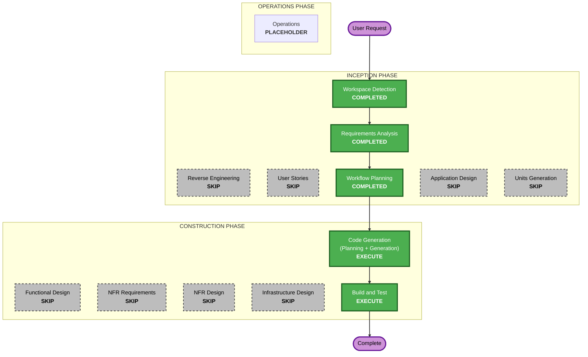

# Execution Plan — Responsive Login/Register Design (LegalWave)

**Unit**: `responsive-auth`
**Date**: 2026-10-31
**Deliverable**: `context-docs/mockups/08-responsive-login-register.html`
**Source requirements**: `aidlc-docs/inception/requirements/responsive-auth/requirements.md`

---

## Detailed Analysis Summary

### Transformation Scope (Brownfield)

- **Transformation Type**: **Single artifact addition** — not a modification to any existing component
- **Primary Changes**: One new self-contained HTML file with inline CSS and JS, added to the existing `context-docs/mockups/` prototype set (alongside `01-login.html` … `07-pdf-on-request.html`)
- **Related Components**: None. The artifact has **no dependency on** the React application, the Python backend, the API contract, or any shared module. It is a standalone document with one permitted external resource (the Google Fonts stylesheet).
- **Blast radius**: Exactly one new file. Zero existing files are created, edited, or deleted. Rollback is a single `rm`.

### Change Impact Assessment

| Impact area | Assessment |
|---|---|
| **User-facing changes** | **Yes** — the artifact *is* a user-facing surface (a login/register page). It does not change the shipped app's auth pages, which keep their own routes and tokens. |
| **Structural changes** | **No** — no module, package, or directory structure changes. `context-docs/mockups/` already exists and already holds this artifact class. |
| **Data model changes** | **No** — no schema, no persistence, no storage of any kind. |
| **API changes** | **No** — no endpoint is added, changed, or consumed. The form makes **no network request** (FR-5.5). |
| **NFR impact** | **Yes** — NFR-1 (accessibility), NFR-2 (responsiveness), NFR-3 (performance), NFR-4 (security) are all new requirements on a new artifact. NFR-4 is additionally hardened by the enabled security-baseline extension. |

### Component Relationships

```
+------------------------------------------------------------------+
|    LegalWave Workspace (brownfield)                              |
|                                                                  |
|   +-------------------------+      +-------------------------+   |
|   |  frontend/              |      |  backend/               |   |
|   |  React 19 + Vite        |      |  FastAPI + LangChain    |   |
|   |  (NOT MODIFIED)         |      |  (NOT MODIFIED)         |   |
|   +-------------------------+      +-------------------------+   |
|                                                                  |
|+----------------------------------------------------------------+|
|| context-docs/mockups/   <- ONLY TOUCHED DIRECTORY              ||
||   01-login.html .. 07-pdf-on-request.html  (UNTOUCHED)         ||
||   08-responsive-login-register.html      (NEW)                 ||
|+----------------------------------------------------------------+|
+------------------------------------------------------------------+
```

- **Primary Component**: `context-docs/mockups/08-responsive-login-register.html` (new)
- **Infrastructure Components**: none — no IaC, no CDK/Terraform, no deployment resources
- **Shared Components**: none — the artifact defines its own local token block; it imports nothing from the app
- **Dependent Components**: none — nothing in `frontend/` or `backend/` references `context-docs/mockups/`
- **Supporting Components**: none

**Change type**: Additive, new file | **Change reason**: Direct user request | **Change priority**: Optional (the mockup set is a design reference, not a runtime dependency)

### Risk Assessment

- **Risk Level**: **Low**
  - One new file; no existing behaviour can regress.
  - The design is exhaustively specified in the brief and locked down by 20 answered questions, so there is little interpretive ambiguity left at construction time.
  - The only genuine unknowns are *visual fidelity* — whether the rendered result matches the user's intent — and the *Google Fonts SRI hash* (SECURITY-13), which is a verifiable, mechanical check.
- **Rollback Complexity**: **Easy** — delete one file.
- **Testing Complexity**: **Simple** — the output-validation checklist from Q20 (unclosed tags, duplicate IDs, ARIA wiring, focus ring, colour tokens) is mechanical and needs no test runner. Manual E2E walkthrough covers the interaction paths.
- **Primary Risks**:
  - **R1 — SRI hash correctness.** A wrong `integrity` hash blocks the stylesheet from loading. Mitigation: compute the hash from the actual served CSS at build time; if it cannot be verified, ship the local Georgia/system-ui fallback path and document the deviation.
  - **R2 — Visual fidelity drift.** The artwork panel has concrete geometry (a `-1.6deg` rotated page, three overlapping cards with SVG connectors). Mitigation: the code generation plan enumerates every specified element (NFR-6.1 is a literal checklist).
  - **R3 — Contrast regression in the light theme.** The cream `#F5F2EC` background with muted `#A09B93` text can fall below 4.5:1. Mitigation: NFR-1.3 requires the muted footer to meet 4.5:1 *in both themes*, forcing a token adjustment in the light override rather than reusing the dark value.
  - **R4 — Reduced-motion path incomplete.** The scan line and the staggered fade are the only two motions; a partial reduced-motion implementation leaves one running. Mitigation: the code generation plan treats the reduced-motion block as a required, separately-verified section.

---

## Workflow Visualization



### Text Alternative

```
Phase 1: INCEPTION
- Stage 1: Workspace Detection  (COMPLETED)
- Stage 2: Reverse Engineering    (SKIP)
- Stage 3: Requirements Analysis (COMPLETED)
- Stage 4: User Stories          (SKIP)
- Stage 5: Workflow Planning     (COMPLETED)
- Stage 6: Application Design    (SKIP)
- Stage 7: Units Generation      (SKIP)

Phase 2: CONSTRUCTION
- Stage 8:  Functional Design      (SKIP)
- Stage 9:  NFR Requirements       (SKIP)
- Stage 10: NFR Design             (SKIP)
- Stage 11: Infrastructure Design  (SKIP)
- Stage 12: Code Generation        (EXECUTE) - Part 1 planning, Part 2 generation
- Stage 13: Build and Test         (EXECUTE)

Phase 3: OPERATIONS
- Stage 14: Operations              (PLACEHOLDER)
```

---

## Phases to Execute

### 🔵 INCEPTION PHASE

- [x] **Workspace Detection** (COMPLETED) — brownfield confirmed; the unit is a standalone static artifact, not an app change
- [x] **Reverse Engineering** (SKIPPED)
  - **Rationale**: The artifact shares no code, data contract, or dependency with the existing system — it is opened directly from disk and consumes no API. Reverse-engineering the app would produce architecture and component documents with no bearing on this deliverable. The workspace detection stage already captured the only facts that matter (the `context-docs/mockups/` convention and the palette divergence between the brief and the shipped tokens).
- [x] **Requirements Analysis** (COMPLETED) — `aidlc-docs/inception/requirements/responsive-auth/requirements.md` (FR-1…FR-8, NFR-1…NFR-6, traceability table)
- [x] **User Stories** (SKIPPED)
  - **Rationale**: Low priority under the assessment criteria. There is one persona (an unauthenticated visitor arriving at the login page), a single screen, and no multi-step workflow. The behavioural acceptance criteria are already fully specified at rule level in FR-4 (validation), FR-5 (behaviour), and NFR-1 (accessibility) — a story document would restate them without adding information. It also touches no team-collaboration or stakeholder-acceptance process that needs a narrative artifact.
- [x] **Execution Plan** (COMPLETED) — this document
- [ ] **Application Design** (SKIP)
  - **Rationale**: Application Design addresses new components, services, method contracts, and service-layer boundaries. This artifact has **no** component or service boundaries — it is one HTML document with one inline `<style>` and one inline `<script>`. There are no method signatures to define, no dependency graph to clarify, and no service layer. The "design" here is visual, and it is fully specified by FR-2, FR-3, FR-6, and FR-7.
- [ ] **Units Generation** (SKIP)
  - **Rationale**: Units Generation decomposes work across multiple units — new data models, new endpoints, complex algorithms, multi-package changes, or infrastructure-as-code. This unit is a single cohesive deliverable in a single file with no data model, no endpoint, no shared state, and no package boundary. Splitting it into units would create coordination overhead for one file.

### 🟢 CONSTRUCTION PHASE

- [ ] **Functional Design** (SKIP)
  - **Rationale**: Functional Design is for new data models, schemas, and complex business rules needing detailed design. The artifact's "business logic" is form validation, and every rule already has a specified plain-language message (FR-4.2) and a specified trigger (FR-4.1). There is nothing left to design — only to write. The validation rule set is enumerated directly in the requirements and will be implemented verbatim.
- [ ] **NFR Requirements** (SKIP)
  - **Rationale**: NFR Requirements is a *requirements-gathering* stage. It has already been executed for this unit: NFR-1 (accessibility), NFR-2 (responsiveness), NFR-3 (performance), NFR-4 (security), NFR-5 (maintainability), and NFR-6 (brief fidelity) are written in `requirements.md`, with the security ones driven by the enabled security-baseline extension. Running the stage again would duplicate an existing artifact rather than add information.
- [ ] **NFR Design** (SKIP)
  - **Rationale**: NFR Design translates already-gathered NFRs into implementation patterns. The implementation patterns for this artifact are fully determined by the requirements: token-driven colours (NFR-5.2), token-override light theme (NFR-5.3), compositor-friendly animation properties (NFR-3.2), ARIA tablist pattern (FR-3.2/3.3), `textContent`-only DOM writes (NFR-4.2), and SRI on the font stylesheet (NFR-4.6). There is no remaining design decision to make.
- [ ] **Infrastructure Design** (SKIP)
  - **Rationale**: Infrastructure Design maps deployment architecture, cloud resources, and environment configuration. The deliverable is a static file with no runtime process, no container, no environment variables, no environment-specific configuration, and no network path beyond one CDN stylesheet request. There is no infrastructure to design.
- [ ] **Code Generation** (EXECUTE — ALWAYS)
  - **Rationale**: The deliverable must be authored. Part 1 produces a step-by-step generation plan; Part 2 writes `context-docs/mockups/08-responsive-login-register.html` and verifies it against the requirements.
- [ ] **Build and Test** (EXECUTE — ALWAYS)
  - **Rationale**: There is no build step for a static file, so this stage becomes a **verification** stage: the Q20 output validation (unclosed tags, duplicate IDs, ARIA wiring, focus ring), a contrast check in both themes, a reduced-motion check, and a manual E2E walkthrough of every interactive path (tab switching, arrow keys, show/hide, validation, demo notices, success card, reset link).

### 🟡 OPERATIONS PHASE

- [ ] **Operations** (PLACEHOLDER)
  - **Rationale**: The artifact is a design prototype, not a deployed service. There is nothing to monitor, deploy, or roll back in production. The stage is retained as a placeholder for future units in this project that do have a runtime.

---

## Package Change Sequence

Not applicable — this unit has a single package and no dependency chain. The one file is created in isolation and depends on nothing.

For completeness, the ordering within Code Generation is:

1. **Token block + base layout** — the `:root` token set (FR-6.1) and the light-scheme override (FR-6.2) must exist first, because every subsequent rule references them (NFR-5.2).
2. **Artwork panel** — background, glow, ruled lines, contract page, highlights, scan line, SVG connectors, annotation cards (FR-2).
3. **Form panel** — tabs, underline, fields, buttons, divider, footer (FR-3).
4. **Validation logic** — rules and message wiring (FR-4), plus the mode-switch reset (FR-5.2).
5. **Success state and demo notices** (FR-3.10, FR-3.11, FR-5.3, FR-5.4).
6. **Motion and reduced-motion overrides** (FR-7).
7. **Verification pass** — output validation and contrast check (NFR-1, Q20).

Steps 1→3 are order-independent within the file (CSS is declarative), but steps 4→6 depend on the DOM ids established in step 3.

---

## Estimated Timeline

- **Total Stages**: 14 (10 executed, 3 skipped, 1 placeholder)
- **Stages to Execute**: Code Generation (Part 1 + Part 2), Build and Test
- **Stages to Skip**: Reverse Engineering, User Stories, Application Design, Units Generation, Functional Design, NFR Requirements, NFR Design, Infrastructure Design
- **Estimated Duration**: Single focused session — one authoring pass plus one verification pass.

---

## Success Criteria

- **Primary Goal**: A single self-contained HTML file that renders the specified responsive login/register design faithfully, works with keyboard and screen readers, honours `prefers-reduced-motion`, and opens correctly from disk with no build step.
- **Key Deliverables**:
  1. `context-docs/mockups/08-responsive-login-register.html` — the artifact
  2. `aidlc-docs/construction/plans/responsive-auth-code-generation-plan.md` — the Part 1 generation plan
  3. `aidlc-docs/construction/build-and-test/` — verification instructions and the E2E checklist
- **Quality Gates**:
  - Every FR and NFR in the requirements document is either implemented or explicitly recorded as an accepted deviation.
  - NFR-6.1's element checklist passes — no specified element is missing.
  - NFR-6.2/6.3 — the specified hex values are used exactly, and no literal colour appears outside the token block (NFR-5.2).
  - NFR-1.3 — body text and the muted footer meet 4.5:1 in **both** themes; focus indicators meet 3:1.
  - FR-3.2/3.3 — the ARIA tab pattern is wired correctly: `tablist`/`tab`/`tabpanel`, `aria-selected`, `aria-controls`, `aria-labelledby`, arrow-key navigation, roving `tabindex`.
  - FR-7.4/7.5 — with reduced motion emulated, the scan line does not animate and the annotations appear immediately.
  - FR-5.5 — the page makes **no** network request other than the font stylesheet; no form submission leaves the page.
  - NFR-4.2/4.5/4.8 — no `innerHTML` with user values, no password stored or logged, no `eval`/`Function`/`document.write`.
  - NFR-4.6 — the font stylesheet carries a correct `integrity` hash and `crossorigin="anonymous"`, or the deviation is documented and the local fallback is used.
  - `frontend/` and `backend/` are byte-for-byte unchanged (FR-8.3).
- **Integration Testing**: Not applicable — the artifact is standalone and is not wired into the app.
- **Operational Readiness**: Not applicable — no deployment or monitoring surface.

---

## Extension Compliance Plan

| Extension | Enabled | How it is honoured in this plan |
|---|---|---|
| **security-baseline** | **Yes** | SECURITY-05, 09, 11, 12, 13, 15 are applicable and are carried as NFR-4.1…4.9, with SECURITY-05/-09/-12/-13/-15 given dedicated construction and verification gates. The remaining rules are N/A (no storage, server, IAM, network policy, or alerting surface) and are marked N/A with rationale in each stage's compliance summary. |
| **resiliency-baseline** | **No** | Not enforced. Every rule targets a deployed, distributed, stateful workload; a static file has no workload to make resilient. |
| **property-based-testing** | **No** | Not enforced. PBT-09 requires adding a test-framework dependency, which conflicts with FR-8.1 (self-contained single file). The verification stage uses the manual output-validation checklist from Q20 instead. |

---

## Approval Gate

This plan is presented for review before Code Generation begins. On approval, the next stage is **Code Generation, Part 1 — Planning**.
