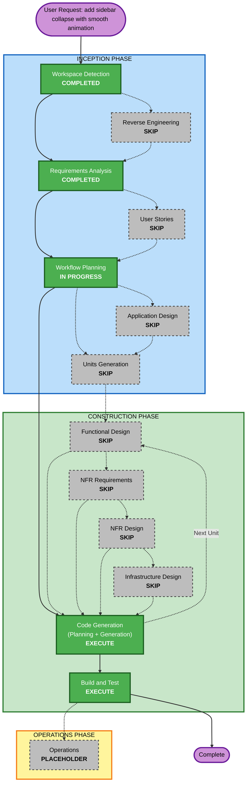

# Execution Plan — Sidebar Collapse Feature

**Unit**: `frontend/` — LegalWave chat workspace sidebar
**Date**: 2026-10-30
**Requirements**: `aidlc-docs/inception/requirements/sidebar-collapse/requirements.md`

> **Amendment — 2026-10-31.** Two changes were made after the plan was executed, both prompted by user reports. (1) The rail originally rendered one shortcut per recent chat; the toggle lived only in the sidebar header, which the collapse CSS fades out — so the sidebar could be collapsed but never reopened. A second toggle was added inside the rail, and the collapsed panel is now `aria-hidden` + `inert`. (2) The per-chat shortcuts were then removed: at 56px they showed no title, so the icons were indistinguishable and the user reported them as noise. The rail now holds only the expand toggle, the brand logo, and the new-chat button. See findings 13–17 in `aidlc-docs/construction/build-and-test/frontend/build-and-test-summary.md`. The plan text below is retained as the record of the original design.

---

## Detailed Analysis Summary

### Transformation Scope (Brownfield)

- **Transformation Type**: Single component change — application layer only
- **Primary Changes**:
  1. `features/chat/components/ChatSidebar.tsx` — add a toggle button, render the collapsed rail (logo, new-chat, per-chat shortcuts), keep the full panel in the DOM and hide it with CSS
  2. `features/chat/pages/ChatPage.tsx` — own the collapsed state, wire the `Ctrl+B` shortcut, own the mobile drawer state, apply the root class
  3. `features/chat/styles/chat.css` — grid-column transition, rail layout, fade-and-slide, drawer + scrim, `prefers-reduced-motion`
  4. `features/chat/hooks/useSidebarCollapse.ts` (new) — collapsed state, `localStorage` persistence, keyboard shortcut, viewport-width awareness
- **Related Components**: none outside `features/chat/`. `shared/api/`, `app/`, and `config/` are untouched.

### Change Impact Assessment

| Area | Impact | Detail |
|---|---|---|
| **User-facing** | **Yes** | The sidebar gains a collapse control; the layout gains an animated resize and a mobile drawer. New behaviour at every viewport. |
| **Structural** | **No** | The feature-based module structure is unchanged. A new hook is added inside `features/chat/` — it does not cross the feature boundary. |
| **Data model** | **No** | No schema, no persisted server-side data. One new `localStorage` boolean. |
| **API** | **No** | No endpoint added, removed, or reshaped. `api-contract.md` is not violated. |
| **NFR** | **Yes** | Performance (no jank, no refetch on toggle), Accessibility (`aria-expanded`, focus management, reduced motion, `Escape`), Dependencies (no new packages) are all directly affected. |

### Component Relationships

```
Primary Component:  features/chat/  (ChatSidebar, ChatPage, useSidebarCollapse, chat.css)

  Shared (read-only, unmodified):
    app/providers.tsx        useSession()  -> user, signOut      [for the sidebar footer]
    app/routes.tsx           chatPath(id), ROUTES                [rail shortcut navigation]
    config/brand.ts          BRAND.logoSrc, BRAND.name          [rail brand lockup]
    features/citations/      CitationModal                      [rendered by ChatPage, unaffected]
    shared/api/              endpoints, types                   [chat data source - unaffected]

  Dependent (modified):
    features/chat/components/ChatSidebar.tsx   -> receives collapsed + onToggle props
    features/chat/pages/ChatPage.tsx            -> owns the state, applies the root class
    features/chat/styles/chat.css              -> .shell grid columns, .sidebar, rail + drawer rules
```

- **Change Type**: Minor (compatible) for all three modified files
- **Change Reason**: Direct dependency — the sidebar's width is defined by the shell grid, and the rail is a new visual state of the same component
- **Change Priority**: Critical (all three must land together — the class, the styles, and the props are mutually dependent)

### Risk Assessment

- **Risk Level**: **Low–Medium**
- **Rollback Complexity**: **Easy** — three files, no data migration, no persisted schema beyond one boolean key; reverting the files restores the current behaviour exactly
- **Testing Complexity**: **Simple–Moderate** — mostly visual/interaction verification; the automated checks (build, lint, selector inventory) cover the structural risk

---

## Risk Register

| ID | Risk | Likelihood | Impact | Mitigation |
|---|---|---|---|---|
| **R1** | **Grid-column transition jank.** Animating `grid-template-columns` forces layout on every frame. On a long chat thread this can drop frames. | Medium | Medium | The animated column is a single fixed-size track; the expensive part (the thread's text layout) reflows only as the track changes width. Verify with the Performance panel during the transition. If jank appears, fall back to animating a CSS custom property consumed by `grid-template-columns`, or animate `width` on the sidebar with `contain: layout`. |
| **R2** | **Text clipped mid-word during the collapse.** The sidebar has no `overflow` rule, so text can spill outside the shrinking column. | **High** | Medium | `overflow: hidden` on `.sidebar` plus a synchronised fade-and-slide on the text layer (FR-3.3). The fade completes at roughly the same time as the width transition, so text is never seen clipped. |
| **R3** | **Chat list remounts on toggle**, losing scroll position and re-running effects. | Medium | High | FR-1.3 mandates that the collapsed state is CSS-driven, never conditional rendering. The list stays mounted; only its visibility changes. |
| **R4** | **`Ctrl+B` fires while the user is typing**, applying browser bold formatting or toggling the sidebar mid-sentence. | **High** | Medium | The handler checks `event.target` against `HTMLInputElement`/`HTMLTextAreaElement`/contenteditable and returns early. `preventDefault()` is called only when the shortcut actually applies. Scoped to the chat workspace only. |
| **R5** | **Mobile drawer conflicts with the desktop collapse state.** A persisted "collapsed" preference could force the drawer open on a phone. | Medium | Medium | The two states are held separately (FR-6.4). The desktop preference is only read at desktop widths; below 768px the drawer starts closed. A resize listener re-evaluates which state applies. |
| **R6** | **A new `localStorage` key collides with, or is cleared by, the existing session keys.** | Low | High | The key is `lw_sidebar_collapsed` — distinct from `jlca_token` / `jlca_user`. The sign-out path removes only the session keys; the preference survives (FR-5.3, NFR-6.1). Verified by inspecting `shared/api/client.ts`'s `logout()`. |
| **R7** | **The new styles collide with existing selectors**, or a selector is dropped when editing `chat.css`. | Low | Medium | The CSS selector inventory check (`aidlc-docs/scripts/css-selector-check.py`) is re-run after the edit and must report **0** cross-file duplicates and no lost selectors. |
| **R8** | **New CSS accidentally hardcodes a colour**, bypassing the design tokens. | Low | Medium | Every new colour references an existing token. Verified by grepping the new rules for raw hex values. |

---

## Workflow Visualization



**Mermaid validation**: parsed successfully against the real mermaid v11 parser (JSDOM + DOMPurify) — `MERMAID PARSE: SUCCESS`, `diagramType: flowchart-v2`.

**Text alternative**:

```
INCEPTION
  1. Workspace Detection ......... COMPLETED
  2. Reverse Engineering ......... SKIP (codebase already mapped in api-contract.md)
  3. Requirements Analysis ........ COMPLETED (16 questions, all recommended answers)
  4. User Stories ................ SKIP (single feature, acceptance criteria already in FR)
  5. Workflow Planning ............ IN PROGRESS
  6. Application Design ........... SKIP (no new component or service boundaries)
  7. Units Generation ............. SKIP (single cohesive unit, 4 files)

CONSTRUCTION
  8.  Functional Design .......... SKIP (no new business logic)
  9.  NFR Requirements ........... SKIP (NFRs specified in the requirements doc)
  10. NFR Design .................. SKIP (no new infrastructure or patterns)
  11. Infrastructure Design ....... SKIP (no infra changes)
  12. Code Generation ............. EXECUTE (T1-T9)
  13. Build and Test .............. EXECUTE

OPERATIONS
  14. Operations .................. PLACEHOLDER
```

---

## Internal Execution Sequence (T1–T9)

This is the internal ordering the Code Generation stage will follow. It is not a set of separate user-facing stages.

| Step | Work | Satisfies |
|---|---|---|
| **T1** | Create `features/chat/hooks/useSidebarCollapse.ts` — collapsed state, `localStorage` read/write with defensive parsing, `Ctrl+B`/`Cmd+B` listener with the text-field guard, viewport-width awareness (`matchMedia`) for the drawer. | FR-4, FR-5, FR-6, NFR-8 |
| **T2** | Add the CSS: `.shell` grid-column transition, `.sidebar-collapsed` root class, rail layout, fade-and-slide for the text layer, `overflow:hidden`, drawer + scrim, `prefers-reduced-motion` block. | FR-1, FR-3, FR-6, FR-7, NFR-1, NFR-3 |
| **T3** | Update `ChatSidebar.tsx` — add the toggle button (`aria-expanded`, `aria-label`, `data-testid`), render the rail's per-chat shortcuts, keep the full panel mounted and hide it with CSS. | FR-1, FR-2, FR-7 |
| **T4** | Update `ChatPage.tsx` — consume the hook, apply the root class to `.shell`, pass `collapsed`/`onToggle` to `ChatSidebar`, render the scrim and drawer. | FR-1, FR-2, FR-6 |
| **T5** | Verify the CSS selector inventory — no selector dropped, no cross-file duplication (mitigates R7). | NFR-3 |
| **T6** | Verify no raw hex colours in the new rules; verify `styles/tokens.css` is untouched (mitigates R8). | NFR-3.4 |
| **T7** | Run `npm run build` and `npm run lint` — zero errors. | NFR-1, NFR-3.1 |
| **T8** | Verify scope containment — `package.json` unchanged, `backend/` unchanged, `shared/api/` unchanged. | NFR-2, NFR-5 |
| **T9** | Update `frontend/README.md` — document the collapse control, the keyboard shortcut, the persistence key, and the responsive drawer. | FR-8 continuity |

---

## Phases to Execute

### 🔵 INCEPTION PHASE
- [x] Workspace Detection — **COMPLETED**
- [x] Reverse Engineering — **SKIPPED** (rationale: the codebase was already reverse-engineered into `api-contract.md` during the MVP; this feature touches only the already-mapped `features/chat/` area)
- [x] Requirements Analysis — **COMPLETED** (standard depth; 16 questions, all recommended answers accepted)
- [x] User Stories — **SKIPPED** (rationale: a single-feature enhancement with acceptance criteria already expressed as FR-1…FR-7 and a traceability matrix; user stories would restate them)
- [x] Workflow Planning — **IN PROGRESS**
- [ ] Application Design — **SKIP** (rationale: no new component or service boundaries — the change stays inside `features/chat/`, and the file layout is fixed by FR-1…FR-3)
- [ ] Units Generation — **SKIP** (rationale: a single cohesive unit across 4 files with no inter-package dependencies and no parallelisable work)

### 🟢 CONSTRUCTION PHASE
- [ ] Functional Design — **SKIP** (rationale: no new business logic; the state machine is two booleans, and the interaction rules are fully specified in FR-1…FR-7)
- [ ] NFR Requirements — **SKIP** (rationale: the NFRs are already specified and quantified in the requirements document — 200ms, `cubic-bezier(0.4, 0, 0.2, 1)`, 56px, 768px)
- [ ] NFR Design — **SKIP** (rationale: no new infrastructure or architectural patterns; the animation is a plain CSS transition)
- [ ] Infrastructure Design — **SKIP** (rationale: no infrastructure changes — no new service, deployment, or environment variable)
- [ ] Code Generation — **EXECUTE** (rationale: implementation planning and code generation required; T1–T9)
- [ ] Build and Test — **EXECUTE** (rationale: build, verify, and produce the test instructions)

### 🟡 OPERATIONS PHASE
- [ ] Operations — **PLACEHOLDER** (rationale: future deployment and monitoring workflows)

---

## Estimated Timeline

- **Total Stages**: 14 (9 executed across this workflow, 5 skipped, 1 placeholder)
- **Stages to Execute**: Code Generation, Build and Test
- **Stages to Skip**: Reverse Engineering, User Stories, Application Design, Units Generation, Functional Design, NFR Requirements, NFR Design, Infrastructure Design
- **Estimated Duration**: One Code Generation pass (9 internal steps) plus one Build and Test pass

---

## Success Criteria

- **Primary Goal**: The chat workspace sidebar collapses to a 56px icon rail and expands again, with a smooth 200ms animation, a persisted preference, a keyboard shortcut, and a mobile drawer — added without changing any other behaviour.
- **Key Deliverables**:
  1. `features/chat/hooks/useSidebarCollapse.ts` — state, persistence, shortcut, viewport awareness
  2. `features/chat/components/ChatSidebar.tsx` — toggle button, rail rendering
  3. `features/chat/pages/ChatPage.tsx` — state ownership, root class, drawer, scrim
  4. `features/chat/styles/chat.css` — transition, rail, drawer, reduced-motion
  5. Updated `frontend/README.md`
- **Quality Gates**:
  - `npm run build` — zero errors
  - `npm run lint` — zero errors
  - CSS selector inventory — 0 lost selectors, 0 cross-file duplicates
  - `package.json` — byte-identical
  - `backend/` — zero files modified
  - `styles/tokens.css` — byte-identical
  - No raw hex colours in the new rules
