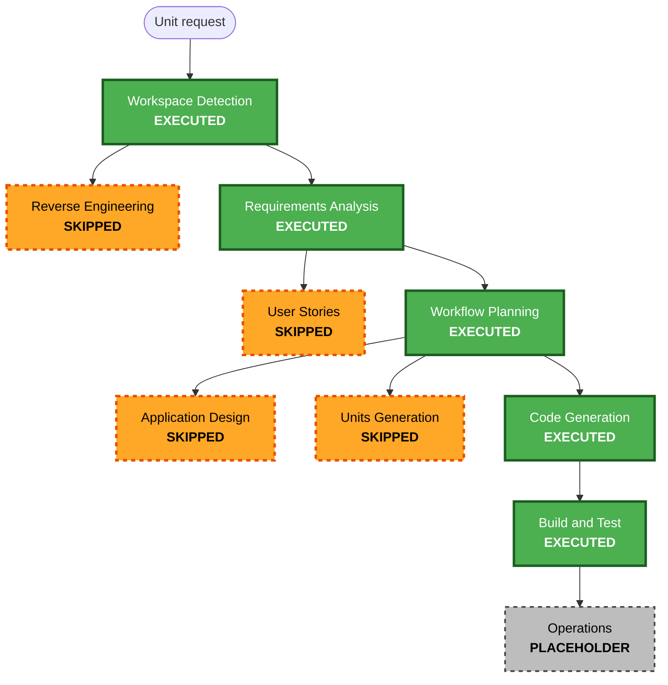

# Execution Plan — `chat-streaming` enhancement unit

**Unit**: `chat-streaming` — sidebar live-refresh + stage-status colouring
**Date**: 2026-11-01
**Risk level**: Low
**Source**: `aidlc-docs/inception/requirements/requirements.md`

---

## 1. Workflow Visualisation



**Text alternative**

```
Phase 1: INCEPTION
- Stage 1: Workspace Detection      (EXECUTED)
- Stage 2: Reverse Engineering      (SKIPPED - architecture already in api-contract.md)
- Stage 3: Requirements Analysis    (EXECUTED - minimal depth)
- Stage 4: User Stories             (SKIPPED - two narrow defects, one persona)
- Stage 5: Workflow Planning        (EXECUTED - this document)
- Stage 6: Application Design       (SKIPPED - no new components or boundaries)
- Stage 7: Units Generation         (SKIPPED - single cohesive frontend unit)

Phase 2: CONSTRUCTION
- Stage 8:  Code Generation         (EXECUTED - Part 1 planning, Part 2 generation)
- Stage 9:  Build and Test          (EXECUTED)

Phase 3: OPERATIONS
- Stage 10: Operations              (PLACEHOLDER - no deployment stage in this workflow version)
```

---

## 2. Stage Plan

| # | Stage | Decision | Reason |
|---|---|---|---|
| 1 | Workspace Detection | **Execute** | Always. Reads the full call path and establishes the two root causes. |
| 2 | Reverse Engineering | **Skip** | `aidlc-bank/aidlc-docs-phase-1-mvp/inception/api-contract.md` already captures the architecture. This unit touches a narrow slice of the frontend whose entire call path has been read directly. Re-running it would add no information. |
| 3 | Requirements Analysis | **Execute** (minimal) | Always. Two narrow defects, no ambiguity, no architectural choice. Minimal depth is the correct fit — the user asked for a fast, small change. |
| 4 | User Stories | **Skip** | No new capability. One persona, two defects, acceptance criteria captured in FR-1…FR-6 / NFR-1…NFR-7 / AC-1…AC-8. A story document would restate the requirements without adding decisions. |
| 5 | Workflow Planning | **Execute** | Always. This document. |
| 6 | Application Design | **Skip** | No new components, no new services, no new component boundaries, no new public interfaces. Two existing components and one existing hook are edited in place; the component contracts are unchanged. |
| 7 | Units Generation | **Skip** | A single cohesive unit. All three changed files share one dependency graph — `ChatPage` renders `MessageView` which renders `StageProgress`, and `ChatPage` wires `useChats` into `useChatStream` — and must land atomically. Splitting would create an intermediate state where the sidebar refresh and the stage fix are half-applied. |
| 8 | Code Generation | **Execute** | Always. Part 1 (planning) then Part 2 (generation). |
| 9 | Build and Test | **Execute** | Always. |
| 10 | Operations | **Placeholder** | No deployment, monitoring or incident-response stage exists in this workflow version. |

**Totals**: 10 stages — 6 executed, 3 skipped, 1 placeholder.

---

## 3. Unit of Work — `chat-streaming`

### 3.1 Files changed

| File | Change | Requirement |
|---|---|---|
| `legalwave-frontend/src/features/chat/pages/ChatPage.tsx` | `onChatCreated` calls `refreshChats()` in addition to navigating | FR-1, FR-2 |
| `legalwave-frontend/src/features/chat/components/MessageView.tsx` | Indicator visibility no longer gated on `!m.content` | FR-3, FR-4, FR-5 |

### 3.2 Files reviewed, expected unchanged

| File | Why reviewed | Expected |
|---|---|---|
| `legalwave-frontend/src/features/chat/hooks/useChats.ts` | Does `refreshChats` preserve the filter and scroll? | Unchanged unless a filter/scroll regression is found (FR-2, NFR-5) |
| `legalwave-frontend/src/features/chat/hooks/useChatStream.ts` | Is the `stage` handler correct? Is `handleEvent` stable? | Unchanged — the `stage` upsert logic is already correct |
| `legalwave-frontend/src/features/chat/components/StageProgress.tsx` | Does it order and render statuses correctly? | Unchanged |
| `legalwave-frontend/src/features/chat/types.ts` | `Stage.status` type, `STAGE_ORDER` | Unchanged |
| `legalwave-frontend/src/features/chat/styles/chat.css` | Are the `.active` / `.complete` / `.pending` rules correct? | Unchanged — NFR-6 |
| `legalwave-backend/app/**` | Any need for a backend change? | Unchanged — FR-6 |

### 3.3 Constraints

- **No `git commit`, no `git push`.** The guardrail is recorded in `aidlc-docs/aidlc-state.md` § Standing Guardrails and in `aidlc-docs/audit.md`. Changes stay uncommitted in the working tree for the user to review.
- `legalwave-frontend/` and `legalwave-backend/` are separate GitHub repositories — file contents only; no repository, remote or branch operations.
- No new dependency. No new frontend file.
- `aidlc-bank/aidlc-docs-phase-1-mvp/` is read-only.

---

## 4. Risk Register

| ID | Risk | Likelihood | Impact | Mitigation |
|---|---|---|---|---|
| R1 | The refresh call races with the navigation, and the sidebar briefly shows a stale list | Low | Low | A single `GET /chats` round-trip; the list updates when it resolves. The navigation is independent of the refresh and both are idempotent. |
| R2 | The re-fetch clobbers the user's search filter or scroll position | Medium | Medium | The filter is separate React state (`query`) and is untouched by `setChats`. Scroll position is verified by the CDP harness; if it regresses, the smallest conforming fix is made in `useChats.ts`. |
| R3 | Keeping the indicator visible while text streams changes the layout undesirably (indicator + text together) | Medium | Medium | The indicator already renders above the markdown body; keeping it mounted after the first token adds the indicator above the text rather than beside it. Verified visually in the by-eye pass. |
| R4 | Removing `!m.content` exposes the indicator for messages that have no stages | Low | Low | `stages.length > 0` remains in the condition, so the indicator only appears once a stage event has actually arrived. |
| R5 | `handleEvent` identity changes cause the `useEffect` on `routeId` to re-run and abort the stream | Low | High | `handleEvent` is a `useCallback` whose deps are `patchLast` and `onChatCreated`. `onChatCreated` must stay referentially stable — it already depends only on `nav`. The refresh call must be added **inside** the existing callback, not as a new inline dependency. This is the single most important implementation constraint of the unit. |
| R6 | The backend emits stages in an order that leaves two stages `active` simultaneously | Very low | Low | The backend emits `X complete` immediately before `Y active` for each transition. Verified against `agent.py:97-144`. |

**Highest risk**: R5 — a change to `onChatCreated`'s dependencies would abort the live stream on every render. The implementation must preserve the callback's current dependency list (`[nav]`).

---

## 5. Verification Plan

| Layer | Tool | Checks |
|---|---|---|
| Static | `npx tsc -b` | 0 errors (NFR-1) |
| Static | `npm run build` | Success, no new dependency (NFR-2, FR-6) |
| Static | `npm run lint` | 0 errors, warning count unchanged (NFR-3) |
| Static | `git diff --stat -- legalwave-backend/` | Empty — backend untouched (FR-6) |
| Static | Purpose-built verifier script | Source-level assertions for both fixes + regression assertions (AC-1, AC-4, AC-6) |
| Behavioural | CDP harness against the **production build** | AC-1, AC-2, AC-3, AC-4, AC-5, AC-8 |
| By eye | Human | Exact colour/animation of the active and complete dots; sidebar entry alignment |

The CDP harness is installed **outside** the repository, matching the pattern used by the previously delivered units, so that the zero-dependency requirement (FR-6) holds.

---

## 6. Execution Checklist

- [x] Workspace Detection — root causes established
- [x] Requirements Analysis — minimal depth, `inception/requirements/requirements.md`
- [x] Workflow Planning — this document
- [x] Code Generation — Part 1: planning
- [x] Code Generation — Part 2: generation
- [x] Build and Test — instructions written (`construction/build-and-test/chat-streaming/`)
- [x] Build and Test — executed (30/30 static checks, 8/8 mutations caught, tsc/build/lint green)
- [x] Build and Test — **live-stack execution pass** (21/21 CDP behavioural checks, 5 consecutive runs; 3 harness defects found and fixed)
- [ ] Post-approval verification pass — the 10 manual scenarios (M-1…M-10) remain for human execution
